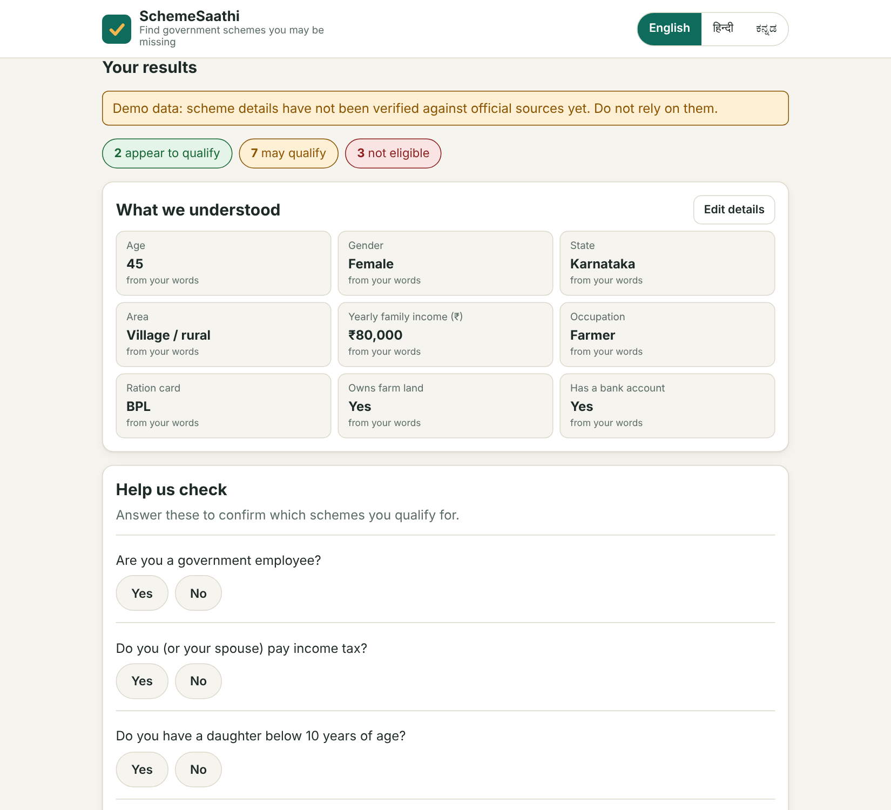
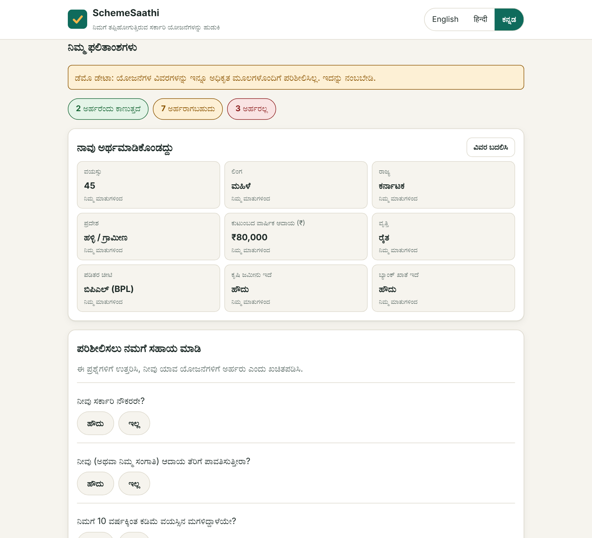
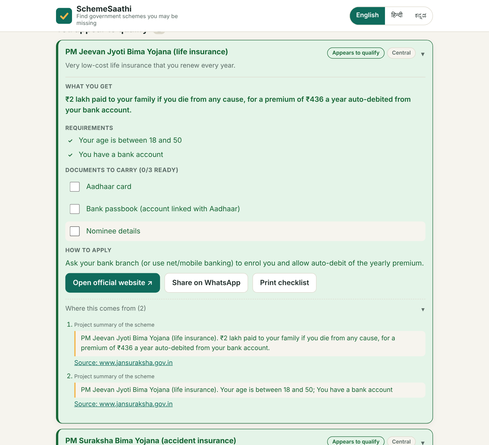
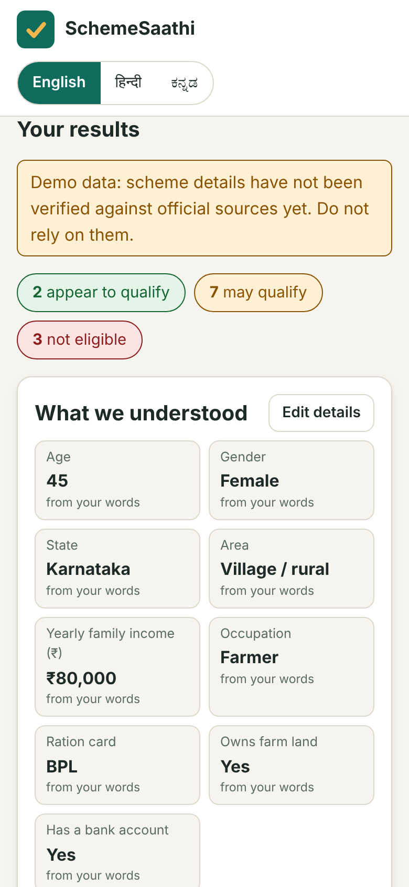
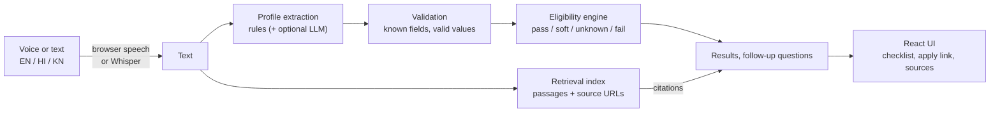

# SchemeSaathi

**Describe your situation in English, Hindi or Kannada — typed or spoken — and find the government welfare schemes you may qualify for, the documents to carry, where to apply, and the source behind every answer.**

Many eligible people never claim benefits because finding the right scheme means reading dense rules, often in a language they don't use. SchemeSaathi turns *"I am a 45 year old farmer in Karnataka with 2 acres and a bank account"* into a short, checkable list.

> **Status: portfolio project, not an official government service.**
> The scheme details in this repository were written from general knowledge and are **not yet verified** against official sources (two schemes are partly confirmed). The app shows a "demo data" warning until every scheme is verified. See [Data verification](#data-verification) **before** showing this to real users.

| | |
|---|---|
|  |  |
|  |  |

## What it does

1. **Understands a free-text or spoken description** in English, Hindi or Kannada (Devanagari and Kannada digits, "1,50,000", "1.5 lakh", monthly vs yearly income, negations like *"no bank account"*, and facts about relatives that are *not* the speaker's).
2. **Checks 12 central and Karnataka schemes** with a deterministic rule engine and sorts them into *appears to qualify*, *may qualify* and *not eligible*, with a tick / cross / question mark for every requirement.
3. **Asks follow-up questions** only for the facts that would settle the most schemes (e.g. "Do you pay income tax?"), one tap each.
4. **Gives what you need to act**: benefit, a document checklist you can tick off, how to apply, a link to the official site, share-on-WhatsApp and print.
5. **Cites its sources** for every scheme, and answers free-form questions from retrieved passages. If nothing relevant is found it says *"we don't have information about that"* instead of guessing.

## Design decisions (the interesting part)

- **The LLM never decides eligibility.** Eligibility is a yes/no question about published criteria, so it is computed by plain, unit-tested rules ([`rules.py`](backend/app/rules.py)). An optional LLM only *reads the description* into known fields, and its output is validated field by field ([`fields.clean_profile`](backend/app/fields.py)), so a wrong or manipulated reply can only ever produce known fields with allowed values.
- **"Not stated" is not "no".** Every criterion is three-valued: *pass / unknown / fail*. A scheme is *not eligible* only when something is contradicted. Missing information gives *may qualify* plus a follow-up question. A test asserts that an **empty profile is never "not eligible" for any scheme**.
- **Rough indicators can't produce a definite "yes".** Some real criteria depend on government lists (e.g. BPL status). Where the app can only approximate them (a BPL ration card), the criterion is marked *soft* and the best possible outcome is *may qualify*.
- **"I don't know" is a feature.** Retrieval has a relevance gate (a passage must share a content word with the question *and* clear a score threshold), so off-topic questions return nothing.
- **People can correct the machine.** Every extracted fact is shown, labelled with where it came from (your words / AI / set by you), and editable. Your edits always win.
- **Privacy by default.** Nothing you type or say is written to disk or logged by the app; uploaded audio goes to a temp file that is deleted immediately (tested, including on failure). See [Privacy](#privacy).

## Architecture



```text
schemesaathi/
├── backend/                     FastAPI service (Python 3.11+)
│   ├── app/
│   │   ├── main.py              HTTP layer: /api/health, meta, analyze, ask, transcribe
│   │   ├── service.py           application logic (no web framework; easy to test)
│   │   ├── rules.py             three-valued eligibility engine
│   │   ├── extract.py           rule-based EN/HI/KN profile extractor
│   │   ├── fields.py            field definitions + translations + validation
│   │   ├── retrieval.py         passages, hybrid TF-IDF embedder, vector index, relevance gate
│   │   ├── llm.py               optional LLM layer (extraction + grounded answers)
│   │   ├── transcribe.py        optional Whisper (faster-whisper) speech-to-text
│   │   ├── ingest.py            turn official PDFs/text into citable passages
│   │   ├── verification.py      data-verification workflow helpers
│   │   └── ratelimit.py, config.py
│   ├── data/                    schemes.json (rules + 3 languages), documents.json
│   ├── eval/                    labelled evaluation sets + scripts
│   ├── scripts/                 ingest_documents, mark_verified, make_verification_checklist
│   └── tests/                   172 pytest tests
├── frontend/                    React 19 + Vite
│   └── src/                     App, components, hooks, i18n (EN/HI/KN), styles
├── e2e/e2e.py                   Playwright browser test (48 checks)
├── docs/                        EVALUATION, DATA_VERIFICATION, RESUME_AND_LINKEDIN, images
└── docker-compose.yml
```

## Quick start

You need **Python 3.11+** (developed and tested on 3.13) and **Node 22+** (the `npm test` script uses Node's built-in test runner with a glob pattern).

```bash
# 1. Backend
cd backend
python -m venv .venv && source .venv/bin/activate      # Windows: .venv\Scripts\activate
pip install -r requirements-dev.txt
pytest                                                 # 172 tests
uvicorn app.main:app --reload --port 8000              # API docs: http://localhost:8000/docs

# 2. Frontend (new terminal)
cd frontend
npm install
npm test                                               # translation completeness
npm run dev                                            # http://localhost:5173  (proxies /api to :8000)
```

**Single process** (UI + API on one port, also how the browser test runs):

```bash
cd frontend && npm run build
cd ../backend && SERVE_FRONTEND_DIR=../frontend/dist uvicorn app.main:app --port 8000   # http://localhost:8000
```

**Docker:** `docker compose up --build`, then open <http://localhost:8080> (nginx serves the UI and forwards `/api` to the backend).

**Browser test:** with the single-process server running, `pip install playwright && playwright install chromium && python e2e/e2e.py`.

No API key or model download is needed for any of the above. Everything optional is off by default.

## Turning on the optional parts

| Feature | How | What you get |
|---|---|---|
| **LLM** | `pip install anthropic`, set `LLM_PROVIDER=anthropic` and `ANTHROPIC_API_KEY` (see `backend/.env.example`) | Better reading of messy, mixed-language descriptions; written answers in the Ask box, grounded in retrieved passages with `[1]` citations. Text you submit is sent to the provider. |
| **Whisper** | `pip install faster-whisper` | Server-side speech-to-text (`/api/transcribe`); the UI uses it automatically when available. First request downloads the model. |
| **Dense embeddings** | `pip install sentence-transformers`, `EMBEDDING_BACKEND=sentence-transformers` | Multilingual semantic search (`intfloat/multilingual-e5-small`). **Re-tune the thresholds** with `python eval/eval_retrieval.py` (the defaults in `retrieval.py` are a starting point only). |
| **Official documents** | `python scripts/ingest_documents.py ./official_docs` (files named `<scheme_id>_*.pdf/.txt/.md`) | Passages from real documents appear as citations, labelled *Official document text*. |

Without Whisper the UI falls back to the browser's built-in speech recognition (Hindi and Kannada support varies by browser).

## API

| Endpoint | Body | Returns |
|---|---|---|
| `GET /api/health` | | status, whether LLM / transcription are on, embedder, number of schemes and how many are verified |
| `GET /api/meta` | | field definitions and translations for rendering forms |
| `POST /api/analyze` | `{text, lang?, overrides?}` where `overrides` maps a field to a value (or `null` to clear it) | `profile`, `field_sources`, `warnings`, `next_questions`, `counts`, and `results[]` (status, per-requirement checks, benefit, documents, how to apply, citations) |
| `POST /api/ask` | `{question, lang?}` | `grounded`, `confidence` (`high` / `low` / `none`), `passages[]`, and `answer` when an LLM is on |
| `POST /api/transcribe` | multipart `audio`, `lang` | `{text, language}`; `501` if Whisper is not installed, `413` if too large |

All endpoints are rate limited per client (default 30 requests/minute; `429` when exceeded). Interactive docs at `/docs`.

## The schemes

12 schemes, each with trilingual text, structured eligibility rules, a document list and an official source URL ([`backend/data/schemes.json`](backend/data/schemes.json)).

| id | Scheme | Level | Official source |
|---|---|---|---|
| `pm_kisan` | PM-KISAN (Pradhan Mantri Kisan Samman Nidhi) | Central | https://pmkisan.gov.in |
| `pm_jay` | Ayushman Bharat PM-JAY (health cover) | Central | https://pmjay.gov.in |
| `apy` | Atal Pension Yojana (APY) | Central | https://www.jansuraksha.gov.in |
| `pmjjby` | PM Jeevan Jyoti Bima Yojana (life insurance) | Central | https://www.jansuraksha.gov.in |
| `pmsby` | PM Suraksha Bima Yojana (accident insurance) | Central | https://www.jansuraksha.gov.in |
| `pmuy` | PM Ujjwala Yojana (free LPG connection) | Central | https://www.pmuy.gov.in |
| `pmay` | PM Awas Yojana (housing) | Central | https://pmaymis.gov.in |
| `ssy` | Sukanya Samriddhi Yojana (savings for a girl child) | Central | https://www.indiapost.gov.in |
| `ignoaps` | Indira Gandhi National Old Age Pension (NSAP) | Central | https://nsap.nic.in |
| `mudra` | PM Mudra Yojana (small business loans) | Central | https://www.mudra.org.in |
| `pm_vishwakarma` | PM Vishwakarma (support for traditional artisans) | Central | https://pmvishwakarma.gov.in |
| `gruha_lakshmi` | Gruha Lakshmi (Karnataka) | Karnataka | https://sevasindhu.karnataka.gov.in |

## Evaluation

Small, hand-labelled sets written by the author, in all three languages. Full details, methodology and caveats are in [`docs/EVALUATION.md`](docs/EVALUATION.md). **Read the caveats before quoting any number.**

| What | Set | Result |
|---|---|---|
| Extraction, **first run** on 18 unseen descriptions | held out | precision 94.4%, recall 93.2%, 14/18 fully correct (the 4 misses were fixed afterwards, so this set is no longer independent) |
| Extraction, 36 descriptions used while developing | development | 36/36 fully correct (optimistic: it was tuned on this set) |
| Retrieval, **first run** on 18 unseen queries | held out | hit@1 83.3%, hit@3 94.4%, MRR 0.898 |
| Off-topic questions correctly returning nothing | held out / development | 2 of 4 / 9 of 11. **This is the weakest number**; the UI warns when a match is weak. |

Reproduce: `cd backend && python eval/eval_extraction.py` and `python eval/eval_retrieval.py`.

## What was tested, and what was not

Be exact about this when you talk about the project.

| Status | What |
|---|---|
| ✅ **Ran and passing** | 172 pytest tests: rules, extractor (EN/HI/KN), retrieval, service, ingestion, verification tooling, the LLM layer (with a fake client), the Whisper wrapper (with a fake module), data consistency. 4 frontend translation tests. 48 Playwright checks in real Chromium: full journey, three languages, error messages, mobile layout with no horizontal scroll, accessible names, tap-target sizes. |
| ⚠️ **Written, never executed** | `backend/app/main.py` (the FastAPI layer) and `tests/test_api.py`. FastAPI could not be installed where this was built. `main.py` was statically checked, and the same `SchemeService` was exercised through a small stand-in server in the browser test. **Run `pytest` and the browser test against the real app first; fix whatever they find.** |
| ⚠️ **Never executed** | `npm install` / Vite dev server / `vite build` (the same source was bundled with esbuild and tested instead). `docker compose`. Deployment. |
| ⚠️ **Never run for real** | Real Whisper transcription accuracy, live LLM calls, the dense-embedding backend, and **voice input in a real browser** (headless Chromium has no microphone). Try each yourself before claiming it works. |
| ❌ **Not done** | Native-speaker review of Hindi/Kannada text. Screen-reader testing. A user study. Verification of scheme facts (see below). |

## Data verification

`schemes_verified: 0` in `/api/health`, and a banner in the UI, until **every** scheme has a verification date.

- Already confirmed against a **PIB release (May 2026)**: PMJJBY premium ₹436 / ₹2 lakh cover / ages 18–50, and PMSBY premium ₹20 / ₹2 lakh cover / ages 18–70. Both stay "unverified" because the rest of each scheme is unchecked.
- Everything else was written from general knowledge. The official portals were not reachable from the build environment.
- [`docs/DATA_VERIFICATION.md`](docs/DATA_VERIFICATION.md) is a generated checklist: for each scheme, what to check and where.
- When you have checked a scheme and corrected the data: `python scripts/mark_verified.py pm_kisan --date 2026-11-05 --note "checked pmkisan.gov.in FAQ"`. When all 12 are done the banner disappears.
- Re-check periodically: scheme rules change. The `last_verified` date is the app's only protection against stale data.

## Privacy

- The backend does not log or store descriptions, questions or audio. Uploaded audio is written to a temporary file and deleted immediately, including when decoding fails (tested).
- **Browser speech recognition** may send audio to the browser vendor's service. The UI says so.
- **If you enable the LLM**, the text a person submits is sent to that provider. Tell users, and check your obligations before deploying publicly.
- Nothing is stored in the browser except the chosen interface language.

## Known limitations

- Eligibility is **indicative**. Real eligibility is decided by the authority, often from government lists the app cannot see. The UI says this on every result.
- The extractor is rule-based: numbers written as words ("पचास हज़ार") are not parsed, and unusual phrasing is missed (the app then asks, rather than guessing). The optional LLM covers more.
- Retrieval is lexical by default: a Hindi question matches Hindi passages, not English ones. The dense option fixes this but needs a model download.
- The index and rate limiter are in memory (single process). Use Redis / a proxy limit and a real vector store (Chroma, pgvector) for multiple workers or a large corpus.
- Only Karnataka-specific schemes are included beyond the central ones.
- Facts are about "you" or "your family" as the person describes them; the app cannot resolve who in a household qualifies.

## Roadmap

Verify and ingest official documents · more states · dense multilingual embeddings tuned on a larger test set · WhatsApp / IVR front end for low-literacy users · installable offline-first PWA · usability study with native speakers.

## License

MIT, see [LICENSE](LICENSE). Scheme names and details belong to their respective government bodies; this project is independent and unofficial.
